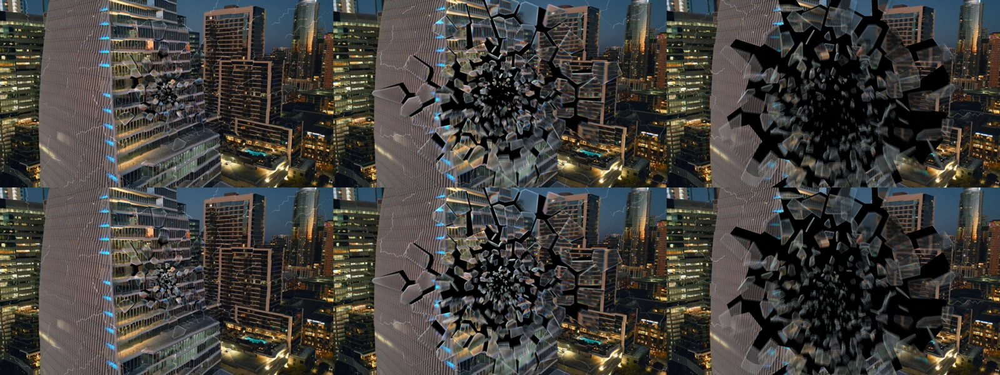
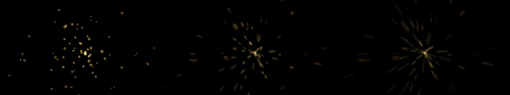
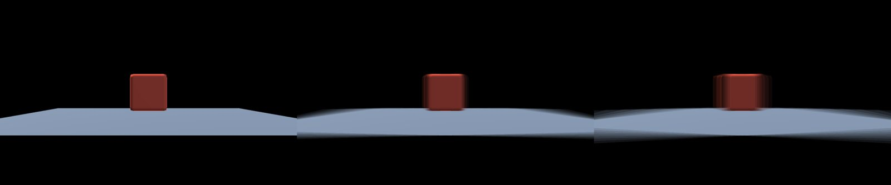
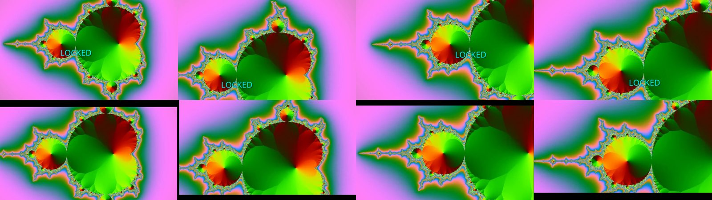
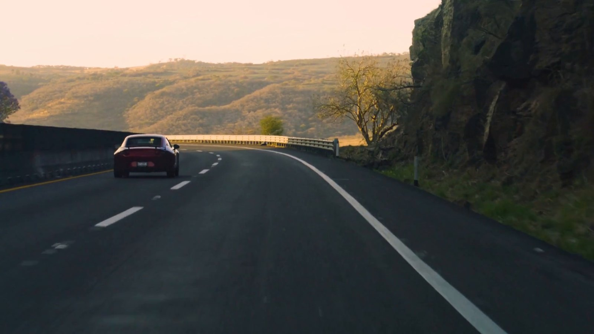
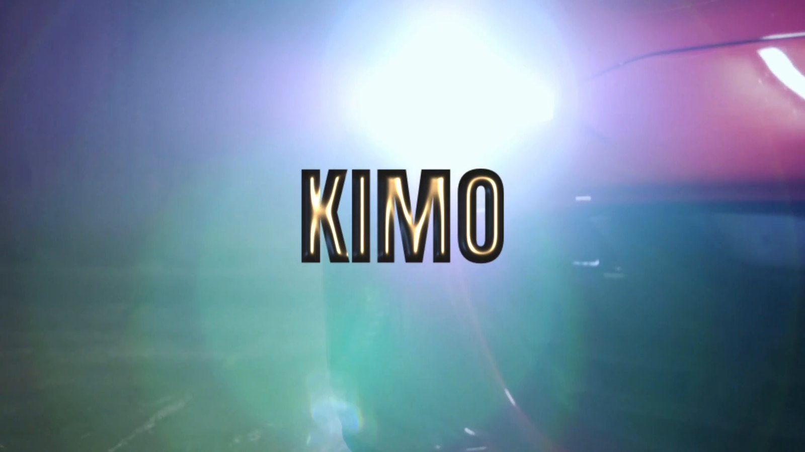
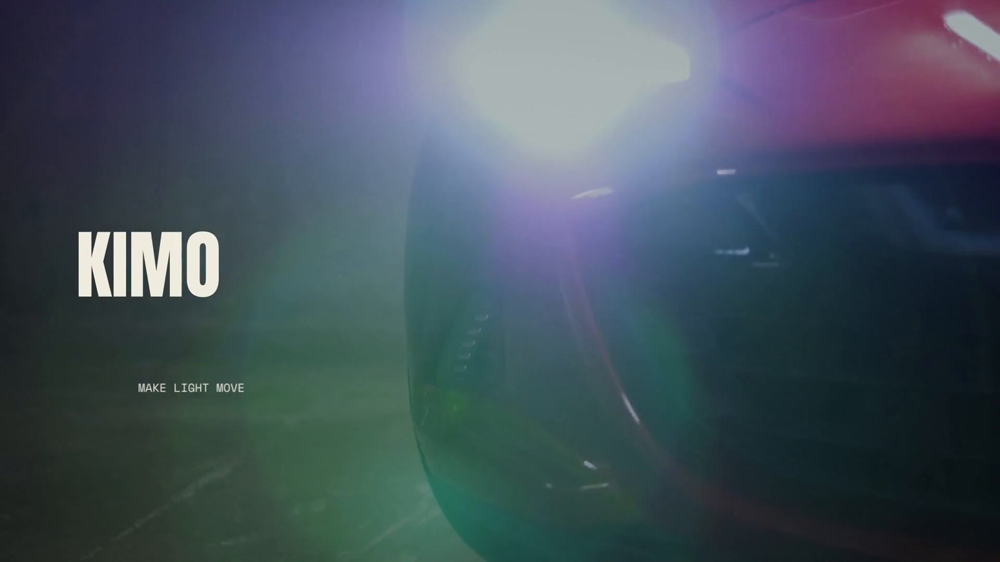

<p align="center">
  
</p>

<h1 align="center">kimo</h1>

<p align="center"><b>A video editor an AI can drive.</b><br>
MCP-first. Every feature is a tool call. Written in Rust, runs on a 2 GB box.</p>

<p align="center">
  
  
  
  
</p>

---

## What it is

kimo is a video editor with no GUI. You talk to it over the [Model Context Protocol](https://modelcontextprotocol.io). Cut, keyframe, grade, track, key, relight, simulate, caption, mix and export are all registered commands, and the MCP server's tool list is generated from that same registry. There is no feature a human can reach that an AI cannot.

The target is the surface of CapCut, After Effects, Premiere and DaVinci Resolve in one engine: editing, motion graphics, VFX, tracking and pro color. It is an early engine with honest tiers. Read [FEATURES.md](FEATURES.md) for what is solid, what is beta and what is not built.

- **MCP first.** Add a tool in the registry and it is in the MCP server, the fuzz test and the schema automatically.
- **CPU, small memory.** The renderer is CPU only and tuned for a 2 GB machine. GPU code is off by default with a CPU fallback.
- **Measured, not claimed.** Every "better than X" line in FEATURES.md has a stated baseline and a measured number, including the cases where we lost.
- **Fuzzed.** 255 tools, 9359 calls, 0 failures, before anything is published.

## Quick start

```
cargo build --release
python3 examples/demo_grade.py        # graded 2-clip sequence with a transition, built only with MCP calls
python3 examples/effects_gallery.py   # renders every effect
```

Needs `ffmpeg` and `ffprobe` on PATH for decode and encode.

Use it from any MCP client:

```json
{ "mcpServers": { "kimo": { "command": "/path/to/kimo/target/release/kimo-mcp" } } }
```

Start with `project_set`, `import_media`, `add_track`, `add_clip`, `add_effect`, `render_frame`, `export`.

## Work made with kimo

These are renders from the engine, driven by tool calls. Some are from the film we are building on it. Where something is still rough, it says so.

### Fracture glass

Glass shards with physical motion, refraction, a shutter-correct motion blur and a damped core so the break starts from the point of impact. Shown on a city plate, top row before core damping, bottom row after. The honest limit: the dark hole where the glass breaks is the revealed backdrop, and a backdrop-aware fill is not built yet.



### Motion blur on particles and on 3D scenes

Both take `shutter_deg` and `blur_samples`, default off. The scene is sampled at several instants across the shutter and averaged in premultiplied space. 3D scene blur re-poses the whole scene per sample, so object animation, parenting and camera moves all blur. Measured on a 1280x720 scene: 0.19 s per frame off, 0.87 s at 8 samples. At 8 samples a very fast move shows stepped copies, so raise `blur_samples`.




### Tracking and stabilizing

Point, planar and mesh trackers, feature tracking with homography fits, long-gap tracking, and diagnostics that report jitter and residuals. The frames below are a synthetic test plate (top: a label pinned to a moving surface, bottom: the stabilized result), so they show the mechanism, not a real-footage result. A confidence score is not pixel lock, and the validation tools can show a track is unreliable, not that it is true. We say that in every report.



### Matting on a real plate

`refine_matte` is a classical (non-ML) trimap matte with chroma-weighted background distance and a self-gate. This frame is a real portrait plate with the background replaced. Edges on the sleeves are still rough; this is the current state, not a cherry-picked best.


### The film

A short film is being built on the engine: a native 1080p rural-road piece with a relit KIMO title, type that sits in the scene, fracture glass and particles. It is the test that drives which engine tools get built next. Engine first, film second. These are frames from the final render.





## What is inside

| Area | Tools |
|---|---|
| Timeline and edit | project_set, import_media, add_track, add_clip, move/trim/split/delete, ripple_delete, ripple_trim, roll_edit, slip_clip, slide_clip, markers, multicam, sync_clips, undo/redo, save/load |
| Look and motion | set_property, set_keyframe (any property, with easing and bezier), expressions, motion paths, motion presets, speed ramps, freeze frame, flow blur, camera shake |
| Effects and transitions | add_effect, add_transition, blend modes, effect masks, adjustment layers |
| Masks and roto | bezier masks, mask keyframes, roto propagation, track mattes, refine_matte, chroma_key |
| Text and graphics | add_text with animators and paths, captions, titles, HUD frames, counters, detection boxes, shapes and path shapes with modifiers, layer styles |
| 3D and relight | add_scene3d, camera, lights, materials, relight, shard bursts, fracture glass |
| Particles and physics | add_emitter, add_particles, simulate_physics |
| Tracking and vision | track_point, track_planar, track_mesh, track_features, stabilize, solve_camera, undistort_clip, validation tools |
| Color | primaries, wheels, curves, HSL, LUTs, ACES and ACEScct, ASC CDL, OCIO, HDR, grade node graphs, scopes, film response, match_grade |
| Audio | fades, EQ, denoise, compressor, echo, pitch, pan, loudness, auto_duck, beat detection and binding |
| Output | render_frame, export, export_alpha, export_gif, export_audio, export_preset, high bit depth, float EXR and TIFF |

The full, current tool list is whatever `tools/list` returns.

## Layout

- `crates/` - `kino-core` (model, keyframes, command registry, CPU renderer, effects, text, audio, tracking, color) and `kino-mcp` (the MCP stdio server). These folders are being renamed to `kimo-*`; the packages and binary are already `kimo-core`, `kimo-mcp`.
- `examples/` - Python client and demos
- `docs/` - design notes and reviews
- `tests/` - the tool fuzz runner

Status: early, CPU renderer. See [ROADMAP.md](ROADMAP.md) and [FEATURES.md](FEATURES.md).

## Contributing and the README rule

The README is updated with every product change. If a change adds, removes or regroups tools, or ships a new proof, the same commit updates this file.

MIT licensed.
