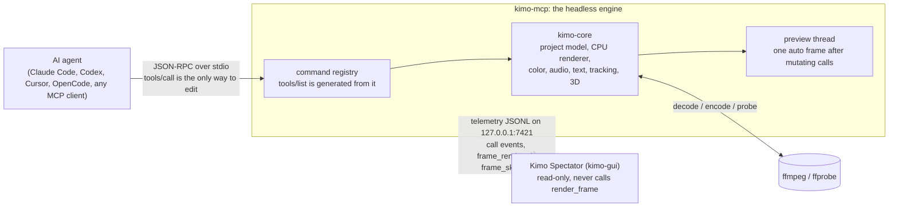

<p align="center">
  <a href="https://getkimo.tech"></a>
</p>

<h1 align="center">kimo</h1>

<p align="center">
  <b>A video editor an AI can drive.</b><br>
  Headless Rust engine. Every edit is an MCP tool call. A live spectator app shows you what the agent is doing.<br>
  <a href="https://getkimo.tech"><b>getkimo.tech</b></a>
</p>

<p align="center">
  <a href="https://github.com/naman-sharma12345/kimo/actions/workflows/kimo-validation.yml"></a>
  <a href="https://github.com/naman-sharma12345/kimo/actions/workflows/release.yml"></a>
  <a href="https://github.com/naman-sharma12345/kimo/releases"></a>
  <a href="LICENSE"></a>
  
</p>

<p align="center">
  <a href="#demo">Demo</a> ·
  <a href="#architecture">Architecture</a> ·
  <a href="#the-mcp-tool-ecosystem">Tools</a> ·
  <a href="#install-prebuilt-installers">Install</a> ·
  <a href="#build-from-clone">Build</a> ·
  <a href="#setup-add-kimo-to-your-ai-client">Connect your AI</a> ·
  <a href="#watching-it-work-spectator-telemetry">Spectator</a>
</p>

---

## Demo

<p align="center"></p>

<table>
  <tr>
    <td width="50%"><br><sub><b>Edit + effects.</b> <code>add_effect</code> lands on the clip; the viewer re-renders on its own.</sub></td>
    <td width="50%"><br><sub><b>A refused render.</b> A broken grade graph gets a "render refused" chip with the engine's reason.</sub></td>
  </tr>
  <tr>
    <td><br><sub><b>A burst of calls.</b> Eight fast moves, coalesced into two preview frames, every call still logged.</sub></td>
    <td><br><sub><b>Audio.</b> Pan, effects and <code>normalize_loudness</code> to -14 LUFS.</sub></td>
  </tr>
  <tr>
    <td><br><sub><b>3D on the CPU.</b> <code>render_scene3d_cpu</code> with <code>cpu_lighting</code>: lit, shadowed geometry.</sub></td>
  </tr>
</table>

Real `kimo-mcp` tool calls (30 calls, 18 tools) streamed to the spectator over loopback TCP and recorded at 1920x1080. Nothing in these frames was staged in the UI.

## What it is

kimo is a video editor with no editing GUI. You talk to it over the [Model Context Protocol](https://modelcontextprotocol.io). Cut, keyframe, grade, track, key, relight, simulate, caption, mix and export are all registered commands, and the MCP server's tool list is generated from that same registry. There is no feature a human can reach that an AI cannot.

The target is the surface of CapCut, After Effects, Premiere and DaVinci Resolve in one engine: editing, motion graphics, VFX, tracking and pro color. It is an early engine with honest tiers. [FEATURES.md](FEATURES.md) lists what is solid, what is beta and what is not built.

## Architecture



- **Headless engine.** `crates/kimo-core` holds the project model, keyframes, the command registry, tool groups, the CPU renderer, effects, text, audio, tracking and color. `crates/kimo-mcp` is the MCP stdio server; `kimo` (`crates/kimo-cli`) is a command line client for the same tools. Decode, encode and probing go through `ffmpeg` and `ffprobe`. The renderer is CPU only; GPU code is off by default.
- **Edits only through MCP tool calls.** Add a tool to the registry and it appears in the MCP server, the CLI, the fuzz test and the schema. There is no side door.
- **The GUI is a pure telemetry spectator.** `crates/kimo-gui` (a Tauri app, its own Cargo workspace) registers zero IPC commands and only listens on loopback. It shows each call, the timeline and the preview frames the engine pushes. It never calls `render_frame` and has no code path back to the engine. Close it and the engine carries on; open it mid-session and it catches up.

More: [docs/ARCHITECTURE.md](docs/ARCHITECTURE.md), [docs/EXTENDING.md](docs/EXTENDING.md), [crates/kimo-gui/README.md](crates/kimo-gui/README.md). An agent editing phone footage into a 9:16 short, call by call: [docs/DIRECTOR_QUICKSTART.md](docs/DIRECTOR_QUICKSTART.md).

## The MCP tool ecosystem

**384/400 live in the default build + 16 feature-gated (8 native-ocio, 8 mesh-import/material-textures/flat-sah).**

A default `tools/list` shows 17 grouped entries; set `KIMO_TOOLS=flat` to list all 400 (see [Tool list profiles](#tool-list-profiles)).

How the numbers fit: `kimo_info` and the golden registry (`crates/kimo-core/tests/golden/golden_registry.txt`) count 398 tools in 14 groups. A flat `tools/list` (`KIMO_TOOLS=flat`) lists 400: those 398 plus the two meta tools `search_tools` and `kimo_describe`. Of the 395, 379 are live in the default build and 16 are feature-gated (8 native-ocio, 8 mesh-import/material-textures/flat-sah); the gated ones stay in the list and answer with a clear refusal until their feature is built in.

398 registered tools sit in 14 groups (full list [below](#tool-listing-398-tools)):

| Area | Groups | Examples |
|---|---|
| Editing | `project`, `timeline` | tracks, clips, trims, ripple and roll edits, speed ramps, multicam, markers, atomic `batch` with undo |
| Motion | `animate`, `effects` | keyframes and Bezier easing, expressions, camera and shake, corner pin, transitions, adjustment layers |
| Compositing | `masks`, `graphics` | mask layers and roto, shapes, HUD frames, counters, boxes |
| Text | `text` | titles, captions, SRT import, text animators |
| VFX | `vfx3d` | code clips (a web page / three.js project drawn per frame), particles, emitters, shard bursts, 3D scene, physics, lights and materials, 3D layer compositor (depth sort, plane intersections, cast shadows, depth of field) |
| Tracking | `tracking` | point, planar and mesh tracking, warp stabilize (smooth or locked, position / similarity / perspective, crop + auto-scale or synthesized edges, rolling-shutter repair), camera solve |
| Color | `color_grade`, `color_science`, `scopes` | grade graphs, curves, ASC CDL, LUTs, ACES and OCIO tools, scopes and exposure analysis |
| Audio | `audio` | clips, effects, beats, loudness, ducking, speech intervals |
| Output | `output` | frame and video export, chunked export jobs, GIF, EXR, manifests, frame lint, contact sheets |

**Principles**

- **MCP first.** Every tool is callable by name. The default `tools/list` is grouped so a client does not read every schema up front.
- **CPU, small memory.** Tuned for a 2 GB machine. A cold release build of the whole workspace took 17 minutes on a shared 2 CPU / 2 GB machine (`CARGO_BUILD_JOBS=1`).
- **Measured, not claimed.** Every "better than X" line in FEATURES.md has a stated baseline and a measured number, including the cases where we lost.
- **Fuzzed.** The v3 notes record 6497 fuzz calls with 0 failures at 327 tools. These numbers come from the project notes. They were not re-run for this README.

### Tool list profiles
`KIMO_TOOLS` picks what `tools/list` returns. Every tool can be called by its own name under every profile.

| Profile | `tools/list` entries | Size | Use when |
|---|---|---|
| `grouped` (default) | 17 | 4,432 bytes | small context windows. Call a group with `action` and `args`; find tools with `search_tools`. |
| `core` | 29 | 20,368 bytes | the most used tools with full schemas, plus `search_tools`, `kimo_describe`, `kimo_enable_group`. |
| `flat` | 400 | 286,762 bytes | clients with large context or their own tool search. Every tool listed with its schema. |
| group names, e.g. `audio,color_grade` | varies | varies | those groups listed flat, the rest grouped. |

Measured on a default-feature `kimo-mcp` built from commit `af615ca` (`initialize`, then `tools/list`; size is the compact JSON of the `result`). `kimo_enable_group` is listed in `grouped` and `core` but not in `flat`. `search_tools(query, limit=8, group?)` returns ranked tools, effects and transitions with the required args and a `call_as` hint.

Set it like this: `claude mcp add --transport stdio --env KIMO_TOOLS=core kimo -- /home/you/.local/bin/kimo-mcp`, or `[mcp_servers.kimo.env] KIMO_TOOLS = "core"` for Codex. For JSON configs add `"env": { "KIMO_TOOLS": "core" }` (OpenCode: `"environment": { ... }`).

## Install (prebuilt installers)

Installers are built by the [release workflow](.github/workflows/release.yml) on GitHub-hosted runners and attached to a **draft** release with a `SHA256SUMS` file. Nothing is published until a maintainer reviews the draft. The builds are **unsigned**. This release ships **Linux and Windows**. macOS is coming later.

Files in the `v5.0.0` release. Check every download against that release's [`SHA256SUMS`](https://github.com/naman-sharma12345/kimo/releases/tag/v5.0.0) (a `.sha256` file also sits beside each engine package).

| OS | File | Status |
|---|---|---|
| Linux x86_64 | `Kimo-Spectator_5.0.0_amd64.deb` | **unsigned draft**, built on CI runners; the same build steps were smoke-tested on Debian 12 at `ca0334f` (install, launch, one rendered frame, uninstall) |
| Linux x86_64 | `Kimo-Spectator_5.0.0_amd64.AppImage` | **unsigned draft**, built on CI runners; run with `--appimage-extract-and-run` was smoke-tested on Debian 12 at `ca0334f`; a normal FUSE launch is not tested |
| Windows x64 | `Kimo-Spectator_5.0.0_x64_en-US.msi` | **unsigned draft, built on CI runners**; CI installs it, launches it, checks the listener (7421, and 7422 with 7421 taken) and uninstalls it on a GitHub Windows runner; not installed on a real Windows PC yet |

Engine (command line) downloads, same release:

| OS | File |
|---|---|
| Linux x86_64 (glibc 2.35+) | `kimo-v5.0.0-linux-x86_64-glibc.tar.gz` |
| Windows x64 | `kimo-5.0.0-windows-x86_64.zip` |
| Windows x64 (installer) | `kimo-5.0.0-windows-x86_64-setup.exe` |

The Windows engine packages are built and packaged by CI on a GitHub Windows runner; they have not been run on a real Windows PC yet.

**Check the download** against the release's `SHA256SUMS`:

```
sha256sum -c SHA256SUMS --ignore-missing                                   # Linux
Get-FileHash .\Kimo-Spectator_5.0.0_x64_en-US.msi -Algorithm SHA256        # Windows PowerShell, compare by eye
```

**Linux (unsigned draft)**

```
sudo apt install ./Kimo-Spectator_5.0.0_amd64.deb      # pulls in WebKitGTK 4.1; remove with: sudo apt remove kimo-spectator
# or, no install:
chmod +x Kimo-Spectator_5.0.0_amd64.AppImage
./Kimo-Spectator_5.0.0_amd64.AppImage                  # no FUSE? add --appimage-extract-and-run
```

**Windows (unsigned draft).** Run the `.msi`. SmartScreen says "Windows protected your PC": click **More info**, then **Run anyway**. The app uses Microsoft Edge WebView2, which Windows 11 already has; on older systems the installer fetches it.

The spectator listens on the first free port of `127.0.0.1:7421`-`7430` (loopback only, never `0.0.0.0`) and the engine finds it there by default, so there is nothing to set: open the app and calls show up. `KIMO_SPECTATOR=off` turns the stream off (see [Watching it work](#watching-it-work-spectator-telemetry)).

## Build from clone

### 1. Prerequisites

All platforms: the Rust toolchain from [rustup](https://rustup.rs), `cmake` and a C++ compiler (the engine builds vendored Manifold), and `ffmpeg` + `ffprobe` on `PATH` at runtime.

<table>
<tr><th>Linux (Debian / Ubuntu)</th><th>Windows</th><th>macOS (from source, untested)</th></tr>
<tr valign="top"><td>

```
curl --proto '=https' --tlsv1.2 -sSf \
  https://sh.rustup.rs | sh
sudo apt install build-essential cmake \
  libssl-dev ffmpeg
# spectator app only:
sudo apt install libwebkit2gtk-4.1-dev \
  libsoup-3.0-dev \
  libayatana-appindicator3-dev \
  librsvg2-dev
```

</td><td>

1. [Visual Studio Build Tools](https://visualstudio.microsoft.com/visual-cpp-build-tools/) with **Desktop development with C++** (MSVC, Windows SDK, CMake).
2. [rustup-init.exe](https://rustup.rs) (default `x86_64-pc-windows-msvc`).
3. [WebView2 Runtime](https://developer.microsoft.com/microsoft-edge/webview2/) (already on Windows 11).
4. ffmpeg, for example `winget install Gyan.FFmpeg`.

</td><td>

```
xcode-select --install
curl --proto '=https' --tlsv1.2 -sSf \
  https://sh.rustup.rs | sh
brew install cmake ffmpeg
# spectator app only:
brew install node
```

</td></tr>
</table>

Linux x86_64 is the tested platform for the engine. The Windows list follows the Tauri and Rust prerequisites; the release workflow builds the engine and the spectator with it on a GitHub Windows runner, but a build from clone on a real Windows PC has not been tried yet.

Step 4 (the spectator app) also needs Node.js 18 or newer for `npx`; the CI jobs use Node 22.

**macOS: no installer in this release, and it has not been built on a Mac here.** The commands in the macOS column and in steps 2-4 are the same ones the Linux and Windows CI jobs run; `crates/kimo-core/build.rs` links `libc++` on macOS. Reports welcome.

### 2. Build the engine

```
git clone https://github.com/naman-sharma12345/kimo.git
cd kimo
cargo build --release --workspace --bins           # on a 2 GB box: CARGO_BUILD_JOBS=1 (cold build ~17 min)
target/release/kimo --version                       # the version in Cargo.toml and the git commit
```

`kimo-mcp` is the MCP server (stdio). `kimo` is the command line client for the same tools.

### 3. Run it headless

`kimo-mcp` takes no required arguments: it reads JSON-RPC on stdin and writes replies on stdout. Your MCP client normally starts it for you.

```
target/release/kimo-mcp                                              # headless MCP server; streams telemetry to the spectator when it is open
KIMO_SPECTATOR=off target/release/kimo-mcp                           # same, with telemetry off
target/release/kimo-mcp --spectator-demo                             # demo mode: one paced frame per call (needs the spectator open)
echo '{"jsonrpc":"2.0","id":1,"method":"initialize","params":{}}' | target/release/kimo-mcp   # quick check
```

The check prints `"serverInfo":{"commit":"...","name":"kimo",...,"version":"..."}`. `--demo-pace-ms <50..100>` sets the demo pace; `KIMO_TOOLS` picks the tool list profile.

### 4. Build the spectator app (optional)

The spectator is its own Cargo workspace in `crates/kimo-gui`. Build it with the Tauri CLI; `npx` fetches it, no global install needed:

```
cd crates/kimo-gui
npx --yes @tauri-apps/cli@2.12.3 build --bundles deb,appimage     # Linux
npx --yes @tauri-apps/cli@2.12.3 build --bundles msi              # Windows
npx --yes @tauri-apps/cli@2.12.3 build --bundles app              # macOS (untested): Kimo Spectator.app
```

The installers land in `crates/kimo-gui/target/release/bundle/`. With Rust only, `cargo install tauri-cli --version 2.12.3 --locked` then `cargo tauri build` is the same CLI.

Then start the spectator first and the engine second:

```
./target/release/kimo-gui &                                          # from crates/kimo-gui; listens on the first free port of 127.0.0.1:7421-7430
../../target/release/kimo-mcp                                        # every tool call now shows up live (no KIMO_SPECTATOR needed)
```

### 5. Connect a client

**Client config.** Use the absolute path of the binary you just built, for example `/home/you/kimo/target/release/kimo-mcp`.

- Claude Code: `claude mcp add --transport stdio kimo -- /home/you/kimo/target/release/kimo-mcp`
- Claude Desktop: add this to `claude_desktop_config.json` (Settings, Developer, Edit Config) and restart the app. The `env` block is optional; `KIMO_TOOLS=core` returns a short `tools/list`.

```json
{
  "mcpServers": {
    "kimo": {
      "command": "/home/you/kimo/target/release/kimo-mcp",
      "args": [],
      "env": { "KIMO_TOOLS": "core" }
    }
  }
}
```

- Cursor: put the same block in `~/.cursor/mcp.json` (all projects) or `.cursor/mcp.json` (one project), then switch the server on in Cursor's MCP settings.
- Generic MCP client (stdio): command = the absolute path, no arguments, optional env as above. Any client that registers a stdio server by command and uses the `mcpServers` shape takes the block as is.

The server itself (launch, `initialize`, `tools/list`) is verified on this build; the client config file locations come from each client's docs, not from a run of those apps here.

Codex and OpenCode use the formats shown under "Setup" below with the same path. `KIMO_TOOLS=core` (env var on the server entry) shrinks `tools/list`; see "Tool list profiles" below.

### 6. Quickstart with the CLI

State lives in a project file (`--project p.kimo`, created on first use). Every command below ran against this build; replace the media path with your own file.

```
K=target/release/kimo
$K -q call add_track --project p.kimo                                  # prints {"track_id":"track1"}
$K -q call import_media --project p.kimo --args '{"path":"/abs/path/in.mp4"}'     # returns asset_id, e.g. asset2
$K -q call add_clip --project p.kimo --args '{"track_id":"track1","source_type":"media","asset_id":"asset2","start":0,"duration":3}'
$K -q call add_title --project p.kimo --args '{"track_id":"track1","style":"lower_third","text":"Hello kimo","start":0.5,"duration":2}'
$K -q call render_frame --project p.kimo --args '{"time":1,"path":"/tmp/f.png"}'  # look at one frame
$K -q call describe_frame --project p.kimo --args '{"time":1}'                    # numbers instead of pixels: stats, histogram, clipping, visible clips
$K -q call contact_sheet --project p.kimo --args '{"path":"/tmp/sheet.png","times":[0,1,2]}'
$K export p.kimo out.mp4                                               # render the timeline
$K tools search "color grade"                                          # find tools by words
$K tools describe add_clip                                             # argument schema of one tool
```

Ids (`track1`, `asset2`) are what the previous call returned, so read them from the output. `export` checks free memory first and refuses with a clear message when the frame would not fit; set `KIMO_MEM_MB` to override its budget. Exit codes: 0 ok, 1 tool error, 2 usage, 3 preflight failed. `kimo --help` lists every subcommand.

## Setup: add kimo to your AI client

kimo is a local MCP server that speaks over stdin/stdout (the "stdio" transport). There is nothing to start by hand: your client launches `kimo-mcp` itself. You only need the path to the binary.

**1. Get the binary** (build from clone, see [Build from clone](#build-from-clone) above) and put it somewhere stable, for example:

```
mkdir -p ~/.local/bin && cp /path/to/kimo/target/release/kimo-mcp ~/.local/bin/
echo '{"jsonrpc":"2.0","id":1,"method":"initialize","params":{}}' | ~/.local/bin/kimo-mcp
```

The second command should print a JSON reply containing `"serverInfo":{"name":"kimo"`. Install `ffmpeg` and `ffprobe` too (`sudo apt install ffmpeg`, or your package manager).

**2. Add it to your client.** Replace `/home/you/.local/bin/kimo-mcp` with your absolute path. Config formats below were checked against each client's public docs on 2026-10-11; client configs change, so if one fails, check the linked page.

### Claude Code
([docs](https://code.claude.com/docs/en/mcp-servers))

```
claude mcp add --transport stdio kimo -- /home/you/.local/bin/kimo-mcp
```

Add `--scope user` to make it available in every project, or `--scope project` to write it to a shared `.mcp.json`. Check with `claude mcp list`, or type `/mcp` inside Claude Code. The same thing as a `.mcp.json` file in your project:

```json
{ "mcpServers": { "kimo": { "command": "/home/you/.local/bin/kimo-mcp", "args": [] } } }
```

### OpenAI Codex (CLI and IDE extension)
([docs](https://developers.openai.com/codex/mcp))

```
codex mcp add kimo -- /home/you/.local/bin/kimo-mcp
```

Or edit `~/.codex/config.toml` (or `.codex/config.toml` in a trusted project):

```toml
[mcp_servers.kimo]
command = "/home/you/.local/bin/kimo-mcp"
```

### Cursor
([docs](https://cursor.com/docs/context/mcp))

Create `~/.cursor/mcp.json` (all projects) or `.cursor/mcp.json` (one project):

```json
{ "mcpServers": { "kimo": { "command": "/home/you/.local/bin/kimo-mcp", "args": [] } } }
```

Then open Cursor's MCP settings and switch the `kimo` server on.

### OpenCode
([docs](https://opencode.ai/docs/mcp-servers/))

Put this in `opencode.json` in your project, or in `~/.config/opencode/opencode.json` for all projects. Note that OpenCode takes `command` as a list and uses `type: "local"`:

```json
{
  "$schema": "https://opencode.ai/config.json",
  "mcp": {
    "kimo": { "type": "local", "command": ["/home/you/.local/bin/kimo-mcp"], "enabled": true }
  }
}
```

### Any other MCP client
kimo is a standard MCP stdio server (protocol 2024-11-05, `initialize`, `tools/list`, `tools/call`). Any client that can register a stdio server by command works: give it the absolute path to `kimo-mcp` and no arguments. Many clients use the `mcpServers` JSON shape shown for Cursor; some (for example Zed) use a different key, so check your client's MCP docs for the exact file and format. Only the four clients above were checked against their docs.

Windows: use the path to `kimo-mcp.exe` (the Windows engine installer `kimo-5.0.0-windows-x86_64-setup.exe` installs per user, no admin rights, into `%LOCALAPPDATA%\Programs\kimo` by default, so the binary is `%LOCALAPPDATA%\Programs\kimo\bin\kimo-mcp.exe` ([kimo.iss](packaging/windows/kimo.iss)); in JSON write backslashes doubled, see the [Windows guide](packaging/windows/WINDOWS.md)). The configs above are the same except for the path; the Claude Code, Codex, Cursor and OpenCode formats were checked on their docs, not tested on Windows here.

**3. Try it.** Ask your assistant: "Use kimo to import /path/to/clip.mp4, add a title, and render a frame." Or drive it yourself with the Python client in `examples/mcp_client.py`.

## Watching it work: spectator telemetry

Kimo's spectator app (`crates/kimo-gui`) connects on its own. Open it and every tool call streams to it live; you don't
set anything. With `KIMO_SPECTATOR` unset or empty (or `on`), kimo-mcp looks for the app on loopback ports
127.0.0.1:7421–7430, in order. It never uses 0.0.0.0 or any other host. It only streams to a peer that answers the
versioned spectator handshake (`KIMO-SPECTATOR/1`; any other answer, an older version included, is a failed
handshake), so a different program holding one of those ports gets nothing. The search runs on the telemetry thread,
never on a tool call. The app takes the first free port in that range and shows "listening 127.0.0.1:<port>".
`KIMO_SPECTATOR=off` (or `0`/`false`) turns telemetry off: no telemetry thread, no events.
`KIMO_SPECTATOR=tcp://127.0.0.1:<port>` pins one port with no scan and no handshake; a host that is not a loopback
address (127.0.0.1, localhost) is ignored and telemetry stays off. `file:/path/events.jsonl` writes the same lines to
a file. A malformed value is treated as off, silently. With no app connected, events are dropped before they are
serialized, and nothing about telemetry is written to stdout or stderr. With an app connected, each tool call sends
a `start` event with the arguments, `progress` for long calls such as `export`, and `complete` with what changed in
the project (or `error`), all under one `call_id`. The stream is
out of band: `tools/list`, results and stdout are byte-identical with it on or off, it never waits for the app,
and with no app listening events are dropped. The app can be opened and closed at any point in a session: the
engine notices a closed window before its next event, reconnects on its own (retrying after 50 ms, doubling to
at most 1 s between attempts, never waiting on the tool calls), and events from while no app was listening are
dropped rather than replayed.
The viewer follows the project live: after any call that changes it (import, add/move/trim/split a clip,
transforms, effects, colour, text...), the engine renders the frame at the playhead in the background and sends it as
`{"type":"frame_rendered","auto":true,"png_b64",...}` (at most 640 px wide; `KIMO_SPECTATOR_FRAME_PX` changes that),
so the app never waits for the agent to call `render_frame`. Read-only calls (`get_*`, `list_*`, searches,
`tools/list`) render nothing. Bursts coalesce, latest wins: the frame renders once no call has arrived for 40 ms (or
400 ms into a long burst, between two calls), one at a time, never while a call is running, on its own thread with
its own decode cache, so tool calls never wait for it. The playhead moves to an explicit `time`/`at` (a split shows
the cut), else into the clip the call touched, and otherwise stays put. Frames are only rendered while an app is
connected (one that opens mid-session gets the current frame at once); with telemetry off or nobody listening
there is no render thread at all (with nobody listening, events are dropped before they are serialized and the
telemetry thread looks for the app again at most once a second), and `KIMO_SPECTATOR_FRAMES=0` keeps the call events but turns the frames off.
The `{"type":"session"}` event and every `{"type":"project_changed"}` carry the project `width` and `height` in pixels
(the size after the call), so the app can place x/y transform moves on the viewer.
`export` progress events carry `current_frame` (frames finished, so the index of the next frame), `total_frames`,
`fps` (the instantaneous rate over the time since the previous progress report) and `eta_ms` (null until the first
frame is done) beside `pct` and `elapsed_ms`. To watch in a plain browser instead of the app, run
`python3 crates/kimo-mcp/tools/spectator_sse_relay.py` and open the UI with `?feed=sse`. Event fields:
`crates/kimo-mcp/src/spectator.rs`.

Call events are strictly one per call: every `tools/call` gets exactly one `start` and exactly one `complete` or
`error`, in call order, with its `call_id` and the request's JSON-RPC id as `rpc_id`, and one `project_changed` per
call that changed the project. They travel on their own lossless lane: never coalesced, never dropped while an app is
connected, and written as whole lines only. An app that is slow to read (a busy window) is waited for, not cut off.
Memory is bounded at 64 MiB of queued events; past that, the next call waits for the app to catch up (backpressure)
rather than losing anything, and nothing ever waits while no app is listening. Canvas frames have a separate
latest-only lane (the newest two), so they can never crowd out, drop or delay call events. Only the headless canvas
frames below coalesce.

Every headless frame a call queues ends as exactly one `frame_rendered` (auto) or one
`{"type":"frame_skipped","skip_reason",...,"call_id","rev","gen","frame_lane_drops","ts_ms"}`. Refusals
(`memory_budget`, `session_busy`, `pq_output`, `hlg_output`, `render_error`, `render_panic`) also carry
`"refused": true` and a human `reason`, and the spectator shows them as a "render refused" chip. Benign skips
(`coalesced`, `superseded_by_render_frame`, `frame_lane_dropped`, `disconnected`) mean a newer frame replaces this one
and carry no reason. Details: `crates/kimo-mcp/src/preview.rs` ("Headless skips").

### Two preview modes

- **Headless (default).** As described above: canvas frames coalesce by call cadence, so a burst of 59 calls 50 ms
  apart shows about 6 frames, and the tool calls never wait for the viewer. Use this for agents and batch runs.
- **Spectator demo mode (opt in).** For watching or recording a session: every tool call gets its own canvas frame,
  rendered from the project exactly as that call left it and tagged with it (`"demo":true`, `seq`, `call_id`,
  `rpc_id`, `tool`). After each call's response the engine holds the next request until that frame has reached the
  app and a pace (50 to 100 ms, default 75) has passed, so each call's change stays on screen. A call that leaves the
  picture unchanged (a read, a failed call) re-sends the current frame with `"same":true`. Demo frames travel on the
  lossless call-event lane, never the latest-only one, so none is dropped. A frame that cannot be
  made is sent as `{"type":"frame_skipped","demo":true,"reason":...}`, so frames and calls always match one to one.
  Turn it on with `KIMO_SPECTATOR_DEMO=on` (or a pace in ms, e.g. `KIMO_SPECTATOR_DEMO=60`), or on the command line
  with `kimo-mcp --spectator-demo` or `kimo-mcp --demo-pace-ms 60` (the command line wins). It needs
  telemetry on (the default; not with `KIMO_SPECTATOR=off`), and it does nothing (no pacing, no renderer) while no app
  is connected. Example:
  `claude mcp add --transport stdio --env KIMO_SPECTATOR_DEMO=75 kimo -- /home/you/.local/bin/kimo-mcp`.
  Pacing was chosen over rendering every frame without waiting because unwaited frames would be rendered after the
  agent had already moved on, so the canvas would trail the timeline and inspector and show the wrong state for a call.

## How an AI sees the tools

Call a group with `{"action": "<tool name>", "args": {...}}`, for example `{"name": "vfx3d", "action": "add_scene3d", "args": {...}}`. Calling a tool by its own name also works.

## Tool listing (398 tools)

This is the list the v3 build registers (read from `tools/list` of the grouped server plus `kimo_describe group=<name>`, 398 tools in 14 groups; the grouped `tools/list` itself shows 14 group tools plus `search_tools`, `kimo_describe`, `kimo_enable_group`). `kimo --version` and `kimo_info` report the workspace version, which is 5.0.0 from this release. Get any tool's arguments with `kimo tools describe <name>` or `kimo_describe`, and find tools by words with `search_tools`.

| Group | Tools |
|---|---|
| `project` (35) | `project_set`, `import_media`, `get_project`, `save_project`, `load_project`, `kimo_info`, `cache_stats`, `cache_clear`, `cache_set_budget`, `undo`, `redo`, `history_list`, `checkpoint`, `restore`, `checkpoint_delete`, `batch`, `list_dependencies`, `collect_project`, `relink_media`, `ext_list`, `set_meta`, `find`, `read_pixels`, `import_pixels`, `project_diff`, `recipe_list`, `recipe_describe`, `recipe_apply`, `set_limits`, `get_limits`, `template_define`, `template_apply`, `template_list`, `template_describe`, `template_delete` |
| `timeline` (39) | `add_track`, `add_clip`, `set_speed_ramp`, `set_time_remap`, `group_clips`, `ungroup_clip`, `set_time_mode`, `freeze_frame`, `move_clip`, `trim_clip`, `split_clip`, `delete_clip`, `set_speed`, `ripple_delete`, `ripple_trim`, `roll_edit`, `slip_clip`, `set_split_edit`, `slide_clip`, `insert_gap`, `lift_range`, `duplicate_clip`, `loop_clip`, `distribute_clips`, `swap_clips`, `rate_stretch`, `add_marker`, `list_markers`, `remove_marker`, `snap_time`, `list_edit_points`, `set_track`, `delete_track`, `split_all_at`, `remove_silence_cuts`, `sync_clips`, `add_multicam`, `switch_angle`, `list_multicam` |
| `animate` (32) | `set_expression`, `set_keyframe_bezier`, `add_camera_shake`, `set_motion_blur`, `set_camera`, `set_camera_keyframe`, `set_corner_pin`, `set_property`, `set_keyframe`, `set_blend`, `set_motion_path`, `remove_motion_path`, `set_flow_blur`, `render_flow`, `get_curve`, `move_key`, `remove_key`, `copy_curve`, `simplify_curve`, `smooth_curve`, `track_beats`, `bind_beats`, `set_mesh_pin`, `apply_motion_preset`, `motion_extract`, `motion_diff`, `set_keyframes`, `sample_property`, `bake_property`, `add_null`, `set_parent`, `get_transform` |
| `effects` (19) | `sample_field`, `sample_noise`, `list_transitions`, `add_adjustment_layer`, `add_speed_lines`, `add_glitch_confetti`, `set_echo`, `set_posterize_time`, `list_effects`, `add_effect`, `set_effect_param`, `remove_effect`, `add_transition`, `set_effect_mask`, `add_managed_linear_effect`, `set_effect_encoding`, `effect_describe`, `effect_uv_sample`, `transition_render_raw` |
| `masks` (18) | `set_mask`, `set_mask_keyframe`, `remove_mask`, `add_mask`, `update_mask`, `remove_mask_layer`, `reorder_mask`, `list_masks`, `set_mask_prop_key`, `set_mask_motion_blur`, `set_mask_path_key`, `roto_propagate`, `track_mask`, `set_track_matte`, `remove_track_matte`, `render_mask`, `track_matte`, `refine_matte` |
| `text` (27) | `add_text`, `set_text`, `import_srt`, `transcribe`, `set_text_style`, `add_text_animator`, `set_animator_keyframe`, `add_title`, `list_fonts`, `set_text_weight`, `set_text_path`, `add_captions`, `add_caption_cues`, `list_captions`, `set_caption_style`, `edit_caption`, `transcript_import`, `transcript_get`, `transcript_edit_word`, `transcript_set_take`, `transcript_coverage`, `transcript_to_captions`, `validate_captions`, `transcript_edit_preview`, `auto_captions`, `edit_caption_words`, `export_captions` |
| `graphics` (20) | `add_box_expand`, `add_shape`, `add_detection_box`, `add_hud_frame`, `add_counter`, `add_prompt_box`, `add_modifier`, `list_modifiers`, `remove_modifier`, `list_shape_modifiers`, `add_shape_modifier`, `remove_shape_modifier`, `list_layer_styles`, `set_layer_style`, `remove_layer_style`, `add_path_shape`, `set_path`, `path_info`, `add_path_key`, `clear_path_keys` |
| `vfx3d` (65) | `add_code_clip`, `set_code_clip_param`, `check_code_clip_determinism`, `add_particles`, `add_emitter`, `add_particles3d`, `set_particles3d`, `add_shard_burst`, `add_scene3d`, `simulate_physics`, `shards_project`, `set_light`, `light_rig`, `remove_light`, `list_lights`, `set_material`, `list_materials`, `remove_material`, `set_relight`, `preview_material`, `particle_simulate_raw`, `inspect_threed_backend`, `inspect_mesh_buffers`, `inspect_scene_matrices`, `raycast_mesh_raw`, `sample_sdf_raw`, `sample_pbr_raw`, `sample_diffuse_sh_raw`, `render_mesh_cpu_reference`, `import_mesh_raw`, `generate_mesh_primitive`, `inspect_mesh_primitive`, `render_mesh_camera_pass`, `ingest_vertex_stream`, `inspect_vertex_stream`, `derive_vertex_tangents`, `export_vertex_stream_obj`, `export_vertex_stream_gltf`, `compile_scene3d_descriptor`, `render_scene3d_cpu`, `render_scene3d_wgpu`, `sample_scene3d_animation`, `render_scene3d_sequence`, `sample_direct_lighting`, `render_vertex_stream_pbr`, `query_flat_sah`, `inspect_sdf_graph`, `sample_sdf_graph`, `contour_sdf_graph`, `transform_vertex_stream`, `instantiate_gltf_scene`, `render_offscreen_mesh_normal`, `sample_texture_material`, `import_gltf_surface`, `render_textured_bvh`, `render_wgpu_pbr`, `sample_advection_field`, `render_particle_flow`, `render_particle_flow_motion`, `mesh_lathe`, `mesh_extrude_path`, `mesh_subdivide`, `mesh_boolean`, `set_3d_compositor`, `set_3d_layer_shadows` |
| `tracking` (30) | `camera_project_points`, `camera_clip_triangle`, `set_ground_plane`, `place_at_track`, `export_st_map`, `track_long_gap`, `track_point`, `stabilize`, `track_planar`, `pin_layer`, `track_mesh`, `solve_camera`, `list_camera_solves`, `camera_solve_info`, `apply_camera_solve`, `grade_node_tracking`, `track_planar_anchored`, `track_features`, `track_set_info`, `fit_track_homography`, `fit_info`, `decompose_track_homography`, `track_jitter_metrics`, `corner_disagreement`, `track_feature_residuals`, `lk_residual_audit`, `ecc_refine_track`, `render_error_field`, `validate_planar_track`, `undistort_clip` |
| `color_grade` (26) | `preview_subject_match`, `match_grade`, `set_color_curve`, `set_color_wheels`, `pick_white_balance`, `pick_key_color`, `auto_color`, `match_color`, `match_shots`, `inspect_asc_cdl`, `apply_asc_cdl`, `generate_lut_node`, `evaluate_grade_graph_samples`, `inspect_grade_graph`, `set_grade_graph`, `add_node`, `connect_nodes`, `disconnect_nodes`, `remove_grade_node`, `set_grade_output`, `set_grade_node`, `set_node_param`, `set_node_mask`, `create_shared_grade_graph`, `bind_shared_grade_graphs`, `remove_shared_grade_graph` |
| `color_science` (18) | `inspect_color_frame_metadata`, `inspect_color_delivery`, `inspect_color_pipeline`, `compare_aces2_reference`, `sample_linear_neutral`, `audit_color_output`, `inspect_float_media`, `set_hdr_mastering`, `set_color_pipeline`, `set_clip_input_color`, `validate_hdr_transfer_math`, `evaluate_hlg_reference_display`, `add_acescct_primaries`, `inspect_high_bit_delivery_contract`, `inspect_film_response`, `inspect_ocio_config`, `transform_ocio_samples`, `transform_ocio_view_samples` |
| `scopes` (12) | `get_scopes`, `compare_linear_exposure`, `render_gamut_excursions`, `analyze_exposure_sequence`, `render_exposure_false_color`, `analyze_exposure`, `analyze_color`, `render_scope`, `render_display_scope`, `measure_loudness`, `inspect_grade_scopes`, `set_grade_scopes` |
| `audio` (17) | `add_audio_clip`, `set_audio`, `set_audio_volume_key`, `detect_beats`, `set_audio_effect_key`, `audio_filter_response`, `audio_effect_describe`, `audio_probe`, `read_samples`, `import_samples`, `audio_transients`, `add_audio_effect`, `remove_audio_effect`, `set_audio_pan`, `normalize_loudness`, `auto_duck`, `audio_speech_intervals` |
| `output` (40) | `export_audio`, `export_gif`, `render_frame`, `export`, `join_export`, `export_alpha`, `export_aces2_reference_video`, `render_aces2_reference`, `render_float_tiff`, `render_float_exr`, `render_high_bit_still`, `export_high_bit`, `export_grade_lut`, `export_camera_solve`, `export_asc_cdl`, `export_color_pipeline_lut`, `contact_sheet`, `describe_frame`, `detect_cuts`, `diff_frames`, `burn_in`, `export_job_start`, `job_status`, `cancel_job`, `resume_job`, `export_manifest`, `explain_invalidation`, `inspect_export_preset`, `export_preset`, `lint_frame`, `match_events`, `render_ocio_display_view`, `preview_range`, `query_safe_margins`, `session_stats`, `solve_constraints`, `export_with_subtitles`, `compute_text_bounds`, `set_ocio_view_delivery`, `export_ocio_view_video` |

## Verification status

- Registry: 398 tools (`crates/kimo-core/tests/golden/golden_registry.txt`, 398 lines). A default-feature `kimo-mcp` lists 400 entries in `flat` mode: those 398 plus `search_tools` and `kimo_describe`. Of the 400, 384/400 live in the default build + 16 feature-gated (8 native-ocio, 8 mesh-import/material-textures/flat-sah).
- Fuzz: 6497 calls, 0 failures, as recorded in the v3 notes at 327 tools. Not re-run for this README.
- Linux spectator installers (`.deb`, `.AppImage`): built on CI runners (dry run at `ca0334f`, then version `0.1.0`; the `5.0.0` files come from the same steps in the `v5.0.0` tag build), downloaded and smoke-tested on Debian 12 x86_64 on 2026-10-17: sha256 matches, the `.deb` installs (`Depends: libwebkit2gtk-4.1-0, libgtk-3-0`) and uninstalls cleanly, and both the `.deb` and the AppImage (`--appimage-extract-and-run`) launch under Xvfb, listen on 127.0.0.1:7421 and draw the `frame_rendered` frames a real `kimo-mcp` (commit `af615ca`) sends after `project_set`, `add_track`, `add_text`. Unsigned draft; other distributions not tested.
- Windows spectator installer (`Kimo-Spectator_5.0.0_x64_en-US.msi`): **unsigned draft, built on CI runners.** CI installs, launches and uninstalls it on a GitHub Windows runner (the `v5.0.0` tag build); not installed on a real Windows PC yet.
- Engine release jobs: the Linux engine tarball is glibc only for this release (the static musl build was dropped). The Windows x64 engine job failed in the first dry run in `crates/kimo-core/build.rs` (MSBuild rejects `cmake --build ... -- -j1`). This release switches to `cmake --build ... --parallel 1` and links the C++ runtime per target (`libstdc++` on Linux, `libc++` on macOS, nothing on MSVC); the Windows engine job then passed on CI (the `v5.0.0` tag build) and its zip and setup.exe are attached. Not run on a real Windows PC yet; macOS not built.
- Windows engine build from clone: not run here.
- Third-party licences for the spectator app: [THIRD_PARTY.md](THIRD_PARTY.md) (five MPL-2.0 crates from the Tauri stack and the LGPL libraries bundled in the AppImage, both decision pending).
- Per-feature limits and change notes: [docs/DEV_NOTES.md](docs/DEV_NOTES.md). Feature tiers: [FEATURES.md](FEATURES.md). Plans: [ROADMAP.md](ROADMAP.md).

## Work in progress (feature branches)

### Coherent fields (feature-branch WIP)
This feature branch adds original raw 2D Perlin/simplex fields, analytic gradients,
MCP point sampling and an animatable noise effect. It is not part of the finalized
v3 release. Compilation, numeric tests, warning delta and real 1080p visual
sign-off are pending. No quality or production-readiness claim is made.
See [the noise plan](docs/noise/PLAN.md) and [verification commands](docs/noise/VERIFY.md).
The next WIP field units add explicit Euclidean Worley F1/F2, FBM, domain warp and
2D potential curl. These are independently selected raw operators, not presets.
They are also uncompiled and unrendered here. See [field units](docs/noise/FIELD_UNITS.md).
### Camera math primitives (feature-branch WIP)
Explicit-pose projection and camera-space near-plane clipping are drafted as raw
MCP math tools. Uncompiled, unrendered, not integrated into the legacy renderer.
They do not yet fix existing Scene3D output. See [camera WIP](docs/camera/WIP.md).
### Raw UV math (feature-branch WIP)
Uncompiled original push/radial coordinate primitives, MCP-callable but not a
rendered transition. See [UV WIP](docs/uv/WIP.md). No visual sign-off.
### Particle simulation primitive (feature-branch WIP)
Uncompiled raw fixed-step 3D trajectory + force/swept-plane math. No emitter or
renderer adapter yet, no visual sign-off. See [particle WIP](docs/particles/WIP.md).

## Contributing and the README rule

The README is updated with every product change. If a change adds, removes or regroups tools, or ships a new proof, the same commit updates this file.

## License

MIT licensed. See [LICENSE](LICENSE). Third-party components of the spectator app: [THIRD_PARTY.md](THIRD_PARTY.md).
