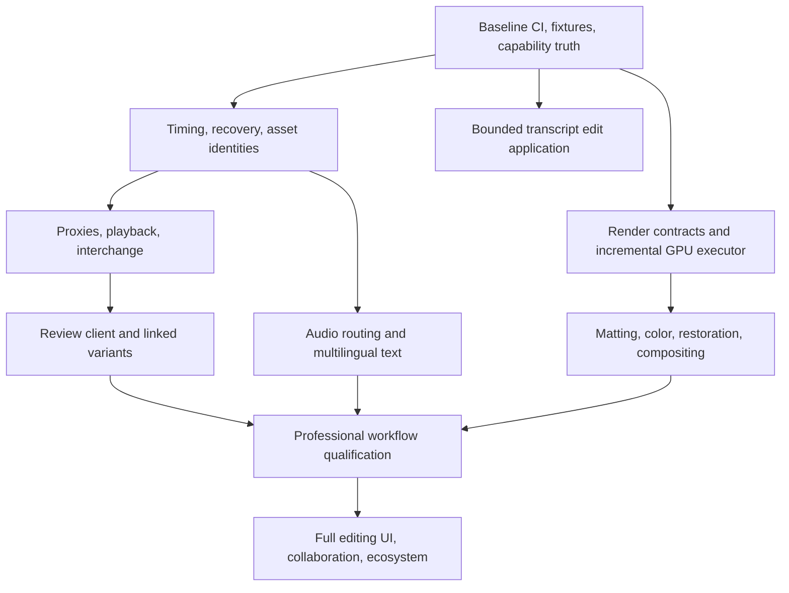

# Professional editor gap analysis and build plan

Assessment: 2026-10-23. Baseline: `v6-all`, commit `98d1bdf`.

Implementation follow-up: the initial F05 transcript-deletion workflow and phrase search have since been added locally. See [usage and support limits](TRANSCRIPT_EDITING.md). The baseline findings below describe the original assessed commit.

This is a source audit and proposed backlog. Implementation presence is not proof of production quality. No competitor applications were run; no Kimo runtime tests, visual comparisons, or benchmarks were run for this assessment. Local Windows `cargo metadata --no-deps --format-version 1` succeeded. Proposed performance/quality thresholds below are targets, not results.

## Recommendation

Kimo has considerable feature breadth. The largest opportunity is to turn that breadth into complete, dependable workflows: editable results from instructions, precise revisions, rapid review, and predictable delivery. Matching the combined scope of Premiere, After Effects, and Resolve Studio is a multi-release engineering program. Adding effect names alone will not achieve it.

Start with foundations and incomplete workflows. Preserve the shared command registry, CPU reference renderer, and existing project compatibility. Add an optional human review/control client through the same command service. A full manual editor is a separate substantial product investment.

A proposed initial market is solo editors and small teams producing interviews, product videos, explainers, and multilingual social content. This focuses the first competitive release; high-end finishing and studio collaboration remain later goals.

## Competitive baseline

Selected capabilities were checked in vendor documentation on the assessment date. These are requirements-setting examples, not exhaustive inventories or independently measured quality claims.

| Product | Relevant documented capabilities | Requirement for Kimo |
|---|---|---|
| Premiere, September 2026 / 26.5 | Transcript-driven Paper Edit, Object Masking, expanded RAW controls, media generation, improved relinking and channel-aware audio matching. [Adobe release documentation](https://helpx.adobe.com/premiere/desktop/whats-new/whats-new.html) | Finish transcript-to-timeline editing, media handling, and revision workflows. An AI interface alone is insufficient differentiation. |
| After Effects, September 2026 / 26.5 | Object Matte disk caching, ACES 2.0/OCIO updates, Advanced 3D depth of field, editable SVG import. [Adobe release documentation](https://helpx.adobe.com/after-effects/desktop/what-s-new/whats-new.html) | Temporal matte quality, compositing correctness, persistent caches, typography, and reusable motion authoring. |
| Resolve Studio 21 family | Accelerated professional-format playback/encoding, temporal and AI spatial noise reduction, HDR finishing, voice isolation, immersive audio. [Studio capabilities](https://www.blackmagicdesign.com/products/davinciresolve/studio) | Measured playback, color/output consistency, restoration, and deeper audio. |
| Resolve Fusion | Node compositing, 2D/3D animation, planar/camera tracking, paint, keying and particles. [Fusion](https://www.blackmagicdesign.com/products/davinciresolve/fusion) | A grade DAG and spectator tool graph do not replace a general image compositing graph. |
| Resolve Fairlight and collaboration | Clip/track processing and third-party audio plugins; shared project workflows across editing and finishing. [Fairlight](https://www.blackmagicdesign.com/products/davinciresolve/fairlight), [collaboration](https://www.blackmagicdesign.com/products/davinciresolve/collaboration) | Buses, automation, stems, review/version management and shared-state consistency. |

## What already exists

**Implemented** means source exists. **Partial** means a significant restriction or incomplete workflow was identified. **Not found** means no implementation was identified in the reviewed sources; it is not a formal whole-program proof of absence.

| Area | Status and evidence | Remaining need |
|---|---|---|
| Shared commands | Implemented: `commands.rs`, `toolgroups.rs`, `ext/mod.rs`, MCP/CLI crates. Checked-in registry golden has 437 rows; this is not a freshly enumerated live count. | Preserve discoverability, contract stability and truthful capability metadata. |
| Timeline editing | Implemented: `edit.rs`, `commands/tools_0.rs`, `ext/editorial_tools.rs`. | Qualify linked A/V, nesting, speed changes, locks and frame-edge behavior together. |
| Multicam | Partial but present: audio/timecode sync, groups, angle switching, continuous selected audio. See `ext/editorial_tools.rs`, `docs/EDITORIAL_MCP.md`. | Embedded timecode, drift correction, long/mixed-rate recording tests. Do not rebuild multicam from scratch. |
| Transcripts/captions | Partial: imports, word corrections, take decisions, coverage and captions in `ext/transcript_tools.rs`; local ASR orchestration in `ext/auto_captions.rs`. | `transcript_edit_preview` explicitly only plans cuts. Applying the plan is missing. External speech binaries/models require setup. |
| History/persistence | Partial: undo, checkpoints, temporary-file save/rename, optional persisted history in `commands/tools_4.rs`. `model.rs` already uses `Arc<Clip>`/copy-on-write, checked by `tests/arc_sharing.rs`. | Automatic durable edit journal/recovery workflow not found. Do not describe every snapshot as deep-copying every clip. |
| Media management | Partial: dependency collection and hash-based relinking in `ext/delivery.rs`, `deps.rs`. | Proxy/original workflow, native timeline interchange and production metadata/conform. |
| Formats | FFmpeg-backed media; `render.rs::check_importable` explicitly rejects numbered image sequences. | EXR/PNG sequence ingest; audited camera RAW, codec and hardware support matrix. |
| Preview/cache | Whole-frame cache in `framecache.rs`; decode windows/static-crop/export optimizations in `render.rs`. Whole-frame cache explicitly excludes export. | Selective node invalidation, persistent analysis caches, proxy-aware playback and scheduling. Kimo already has caching. |
| GPU | Narrow partial paths: `gpu3d`, `threed/offscreen_wgpu.rs`, including a normal pass. `threed/backend.rs` still advertises a scaffold contract. | Reconcile capabilities; general accelerated timeline/compositing executor not identified. A feature flag/fixture is not full GPU editing. |
| Color | Substantial partial implementation: `color/pipeline.rs`, `color/node_graph.rs`, `ext/grade_graph.rs`, OCIO modules, scopes/high-bit export. | End-to-end domain/alpha consistency, packaged configurations, monitoring and mastering qualification. |
| Alpha export | `export_alpha` in `commands/tools_4.rs` declares straight alpha, no audio, managed-color-off restriction. | Managed color plus transparency plus audio as a complete delivery workflow. |
| Roto/keying | Mask stacks, tracking, classical `refine_matte`, temporal `track_matte` already exist. | Promptable semantic segmentation, temporal identity and measured hair/occlusion quality. |
| Motion/VFX/3D | Keyframes, expressions, precomps, particles, trackers, geometry/material modules, code clips; some import/material features gated. | Complete-scene quality/performance, coherent scene integration and reusable authoring. |
| Typography | `text.rs::layout` uses character-based `ab_glyph` advances/kerning. | Shaping, bidi, fallback, combining marks, native Hindi/Arabic, emoji and cluster-aware animation. Transcription/transliteration does not solve text rendering. |
| Audio | Effects, loudness, ducking, pan and mixing; limitations documented in `docs/EDITORIAL_MCP.md`. | Buses/sends, automation, tails, channel layouts, true-peak-aware workflows, separation and plugin hosting. |
| Jobs/QC | Chunk reuse, status, cancel/resume in `ext/export_job.rs`; frame/caption/color/edit quality tools already exist. | Durable scheduling, multi-deliverable qualification and usable review reports. Extend the existing queue. |
| Human UI | `crates/kimo-gui/README.md`: read-only spectator with no editing IPC. | Optional review/control, then full editing workspace if pursuing broad manual-editor replacement. |
| Validation | 267 top-level Rust integration test files and fast/full gate scripts. Counts do not establish pass status. `kimo-validation.yml` triggers only on `val-pbr`; release workflow is tag/manual driven. | Routine current-source PR/`v6-all` CI and observed platform results. |

Source paths in this table are relative to `crates/kimo-core/src` unless otherwise specified. Historical portions of `FEATURES.md`, `docs/ARCHITECTURE_AUDIT.md`, and `docs/MASKING_ROADMAP.md` mix old and new status. Several previously missing items now exist; source and observed tests take precedence.

## Prioritized backlog

P0 = trust/iteration foundations. P1 = initial competitive workflow. P2 = broader professional parity. P3 = specialist breadth. Relative effort: M = cross-module, L = major subsystem, XL = multi-release program. These are scope estimates, not calendar commitments.

| ID | Priority / effort | Work package | Dependencies | Acceptance evidence |
|---|---|---|---|---|
| F01 | P0 / M | Reproducible baseline, routine PR CI, capability/feature-gate truth. | None | Default/selected-feature gates, registry/schema compatibility, real FFmpeg fixtures; reasons for skips; recorded Windows/Linux results. |
| F02 | P0 / M | Durable autosave/journal, recovery discovery, migrations, interrupted-save handling. Extend current saves/history. | F01 | Process-kill/write-boundary tests recover acknowledged durable edits, preserve last good save, safely reject corrupt tails; Windows overwrite/replacement tested. |
| F03 | P0 / L | Exact frame/sample time abstraction, rational rates, VFR PTS mapping, linked A/V invariants; preserve seconds-based APIs. | F01 | Long 24000/1001, 30000/1001, 60000/1001 and VFR fixtures retain correct frames/sync; legacy timing preserved. |
| F04 | P0 / M | Reproducible performance/quality corpus with hardware, drivers, codecs and settings. | F01 | Raw cold/warm cache, seeks, dropped frames, export, memory and task-completion evidence. |
| F05 | P1 / M | Apply transcript cuts/reorders with explicit word-to-clip bindings, revision checks, linked A/V, captions/keyframes and undo. | F01; bounded timing subset before F03 completes | Text deletion changes picture and sound; stale plan refused; unsupported/locked edits fail atomically; undo restores exact state. |
| F06 | P1 / L | Proxy/original variants, background transcodes, waveform/thumb indexes and offline diagnostics. | F01/F03 for general VFR | Proxy toggle preserves frame identity/timing; export uses originals; stale proxies refused; cancellation leaves no valid-looking partial asset. |
| F07 | P1 / L | Playback service: streaming decode, read-ahead, A/V clock, seek cancellation and quality levels. | F03/F04/F06 | Proposed gate: sustained 1080p24 proxy playback on a defined 10-minute layered fixture on named hardware; no unreported drops; p95 warm seek <=150 ms. Cold seeks reported separately. |
| F08 | P1 / XL | General render IR, explicit render context, effect contracts, selective cache invalidation, GPU compositing and CPU fallback. | F01/F04; align F03/F07 | Explicit color/alpha/time inputs, reusable unchanged nodes, CPU goldens, preregistered per-effect GPU tolerances, visible adapters/fallbacks. Start transforms/blends/masks/color/blur. |
| F09 | P1 / L | Timeline interchange: bounded OTIO subset first; FCPXML/EDL and evaluated AAF later. | F03/F06 | Cuts/tracks/source ranges round-trip on real projects; unsupported effects/transitions get warnings or rendered handles. No promise of lossless `.prproj`/`.aep` translation. |
| F10 | P1 / L | EXR/PNG sequence ingest: ranges, missing-frame policy, alpha/color metadata and source timecode. | F03/F06 | Keep sequences without a lossy intermediate; diagnose missing/duplicate frames and mixed dimensions. |
| F11 | P1 / L | Multilingual shaping/bidi/fallback, script-aware wrapping, cluster animation and glyph diagnostics. | F01 | Visually checked Hindi/Arabic/mixed-script/emoji; no silently skipped glyphs; grapheme/glyph-cluster animation; timed/legible subtitles. |
| F12 | P1 / L | Optional review/control client: play/scrub, compare candidates, inspect revisions, correct captions/parameters, accept/revert. | F02/F07; shared command service | Agent/human operations use identical validation/history/revisions; accessible keyboard control; standalone spectator preserved. |
| F13 | P2 / XL | Full interactive editor: trim modes, source/program viewers, timeline, curves, scopes, nodes, keyboard customization. | F12/F08 | Professional users complete defined editing/motion/color tasks; usability/accessibility evidence. |
| F14 | P1 / L | Promptable segmentation, temporal identity, correction keys, uncertainty and cached mattes. | F04/F06; F08 for acceleration | Held-out hair/smoke/blur/occlusion/re-entry/low-light clips; alpha/edge error, flicker and cleanup time versus approved references. |
| F15 | P2 / L | Tracking/roto: bidirectional tracks, re-anchoring, lens/rolling shutter, occlusion confidence, clean plates/object removal. Reuse current trackers. | F04/F14 | Real screen replacements and handheld shots; trajectory/edge error and cleanup time; surfaced failures rather than silent drift. |
| F16 | P1 / L | Scene-linear color/alpha consistency through ingest/effects/composite/preview/output; packaged OCIO configs. | F04/F08 incrementally | SDR/PQ/HLG, premult edges, highlights/negative values and tagged delivery checked against independent references; no silent clips/double transforms. |
| F17 | P2 / XL | Reference monitoring, camera-log/RAW interpretation, shot matching, HDR trims and mastering deliverables. | F16/F06 | Qualified output hardware and per-format tests. Dolby/DCP-specific features need separate engineering/licensing evaluation. |
| F18 | P2 / L | Restoration: motion-compensated temporal/spatial denoise, deblur/upscale, grain/lens matching, motion interpolation. | F04/F08 | Held-out motion/detail/skin/noise; ghosting/texture quality plus objective metrics/runtime. |
| F19 | P1 / L | Stereo audio completion: buses/sends, effect order, automation, tails, true-peak-aware normalization, crossfades and stems. | F03/F04 | Independent reference audio; no clicks, cropped tails, channel swaps or normalization clipping; stems reconstruct specified mix. |
| F20 | P2 / L | Diarization, multilingual ASR, voice isolation/dialogue repair, music/source separation and pitch-preserving retime. | F04/F19 | Held-out WER/timing per language/accent, overlap/speaker metrics, audio artifacts; model versions/resources recorded. |
| F21 | P2 / XL | General image compositing graph, reusable motion groups/macros, published parameters, paint/clone, rigs/puppet deformation. | F08/F11 | Finished title/keying/tracking/paint jobs; deterministic seeds; clear cycle/domain errors; existing grade graphs compatible. |
| F22 | P2 / XL | Consolidate 3D paths/import/material tools, texture/color handling, motion blur, HDRI and transparency. | F08/F16 | Real imported assets, mixed 2D/3D scenes, truthful gates and reference lighting/alpha/DOF. Reconcile existing paths before a renderer rewrite. |
| F23 | P2 / L | Bins/metadata search, embedded timecode, multicam drift correction, archive/consolidate and codec/camera support matrix. | F03/F06/F09 | Long recordings, renamed media, mixed rates and moved/archived projects reopen correctly. |
| F24 | P2 / L | Durable scheduling, retries, multiple deliverables and optional workers on existing render jobs. | F02/F08/F16/F19 | Restart/resume, stale-dependency tests, complete picture/audio/subtitle reports; failed output never marked complete. |
| F25 | P2 / XL | Team comments, timecode review, versions, permissions, conflict detection and shared media/cache. | F02/F03/F12 | No silent concurrent overwrites; explicit conflicts; access/offline reconnect tests. Asynchronous review before live co-editing. |
| F26 | P3 / XL | Versioned extension SDK, isolated effect/audio workers, OFX/VST3 feasibility, templates/assets. | F08/F19/F21 | API/ABI checks, crash isolation, qualified offline render, SDK/license evaluation. Hosting does not imply every commercial plugin works. |
| F27 | P3 / XL | Immersive/surround, stereo/VR, high-end conform, advanced simulations and farm scale. | Relevant P2 foundations | Separate customer-backed requirements and platform/format qualification. |

Model-heavy features need a shared cancellable job/runtime layer, checked downloads, model/version provenance, CPU/GPU capability checks, bounded memory and offline availability. Evaluate runtime and model-weight licenses separately. Bundling/downloads/cloud inference must be explicit product choices; no model is assumed bundled or redistributable.

## Potential differentiation

These are proposed advantages to test, not established superiority. Competitors already ship AI, automation and APIs.

1. **Revision-safe instruction edits.** Produce a concrete plan, affected clips/regions, expected revision and review frames; apply as one reversible transaction. Extend existing `batch` dry-run/revision checks and project/edit comparisons.
2. **Preserve-approved-work constraints.** "Change the headline; preserve timing, logo and grade" becomes state/pixel checks over specified times/regions. Distinguish exact property guarantees from sampled visual comparisons and disclose coverage.
3. **Linked deliverable variants.** Landscape, portrait, square, language and duration variants share source IDs with explicit overrides; revisions propagate predictably.
4. **Evidence-backed visual revision loop.** Candidates include review frames, legibility/loudness/timing checks, unmet requirements, measured render cost and reversible alternatives. QC tools support human judgment rather than automatically certifying creative quality.
5. **Searchable local media/subject index.** Search dialogue, visible content and identity; reuse approved tracks/mattes across reframing, graphics and color, with confidence and timestamps.
6. **Portable reproducible edits.** Package sources, fonts, LUT/config references, seeds, model versions and engine identity, building on current collection/manifests. Separate exact CPU from tolerance-based GPU reproduction.
7. **Reusable editable styles.** Translate references into inspectable typography/rhythm/motion/grade parameters; label inferred approximations instead of promising identical arbitrary-video reconstruction.

## Delivery sequence

First implementation tranche:

1. **F01/F04: baseline and evidence.** Wire current-source CI, enumerate capabilities, define fixtures and record fresh measurements.
2. **F05: transcript edit application.** Begin deletion on explicitly bound normal-speed media; refuse ambiguous mappings, speed ramps, unsupported nested cases and locked linked tracks. Update captions and support one-step undo. Expand when invariants are tested.
3. **F02/F03: recovery and time.** Introduce migrations needed for playback, interchange and audio.
4. **F06/F07, then F09/F10:** proxy-aware playback, interchange and sequence ingest.
5. **F08/F16:** render/color contracts and accelerated hot paths, alongside typography/audio completion. Build matting and compositing on this foundation.

This gives an immediately useful new feature while fixing foundations that would make later additions fragile. Workstreams must share project/time/color/command contracts.

## Evidence required for a superiority claim

Use identical inputs, named hardware, fixed application/build versions and settings. Record codec/driver, cache state, proxies and models. Human operators must be proficient in each application. For Kimo, include instruction, correction, review/export time, model cost and retries. API-call latency versus another editor's total human job time is not a fair comparison.

| Job | Measures | Proposed success criterion |
|---|---|---|
| Talking-head recording to captioned short | Hands-on/review time, incorrect cuts, word timing, final quality | >=30% lower median hands-on time on held-out jobs with equal-or-better blind preference and no increase in material errors. |
| Approved ad to 3 aspect ratios and 2 languages | Revision time, preserved content, crop/text errors | All variants pass declared constraints; >=30% less hands-on time than measured baseline. |
| Targeted revision | Scope correctness, unintended changes, undo fidelity | Every preserved property passes; review coverage disclosed; exact undo state. |
| Long project proxy editing | Seek percentiles, drops, memory, A/V sync | F07 fixture target on published hardware within its documented memory budget. |
| Roto/screen replacement | Edge/trajectory error, flicker, cleanup time | Non-inferior quality and less correction time on held-out clips, including occlusions/failures. |
| Managed-color/alpha delivery | Decoded values/tags, transforms, highlights/edges | Independent numeric/visual references pass; metadata alone is not mastering proof. |
| Interrupted session/export | Recovered edits, corrupt files, resumed work | Every acknowledged durable edit survives process-kill fixtures; corrupt output never reported successful. |

The 30%/latency thresholds are proposed targets to preregister, not present capabilities or universal claims. Outcomes should determine priority changes.

## Scope of this change

This assessment adds a backlog and refreshes the stale roadmap. It implements no runtime features and does not claim passing tests or competitive quality. No dependencies/models were installed and nothing was committed, pushed or published. The next concrete coding feature is F05 after establishing the current baseline.

## Implementation update: preview proxies

The initial F06 slice now provides synchronous validated SDR/CFR proxy generation, persisted undoable bindings, preview switching, original-media exports, stat/deep-hash diagnostics and byte-identical relinking. See [workflow and limitations](PROXY_WORKFLOW.md). Background queues, VFR mapping, waveform/thumb indexing, streaming playback and real-camera performance qualification remain open.
